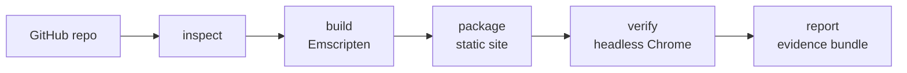

<div align="center">

# browser-port

### Turn an open-source C/C++ SDL or raylib game into a link anyone can play, in one command, or get an honest reason why not.

[](https://github.com/Abelo9996/browser-port/actions/workflows/ci.yml)
[](LICENSE)
[](package.json)
[](#use-it-with-your-agent)

<a href="https://abelo9996.github.io/browser-port/"></a>

<sub>A C + SDL2 Tetris clone, built to WebAssembly by browser-port and played in headless Chrome during <code>verify</code>.</sub>

**Play the ported programs in your browser: [SDL Tetris](https://abelo9996.github.io/browser-port/sdl-tetris/) (C + SDL2) · [brainheck](https://abelo9996.github.io/browser-port/brainheck/) (C terminal program)**

[Try it](#try-it) · [Use it with your agent](#use-it-with-your-agent) · [Real ports](#real-ports) · [How it works](#how-it-works) · [Limits](#what-it-cant-do)

</div>

---

Found a great open-source C or C++ game that only runs on someone's desktop? Point browser-port at the
repo. It checks whether the code can run in a browser, works out the sources, libraries, and assets on
its own, compiles to WebAssembly with Emscripten, reads and fixes common build failures, packages a
static site, then opens it in a real browser and proves it works. You get a folder you can put on any
static host, a measured frame rate, and a report of everything that was done and checked, or an honest
"not supported yet" with the blocker named.

## Try it

> Not on npm yet. Until the first release, install from GitHub:

```bash
git clone https://github.com/Abelo9996/browser-port && cd browser-port
npm install && npm run build && npm link       # puts `browser-port` on your PATH
brew install emscripten                         # or have Docker running for the emscripten/emsdk image
npx playwright install chromium                 # the browser `verify` uses
```

Then port a game in one command:

```bash
browser-port port https://github.com/ryanpcmcquen/basque
```

It inspects, derives the sources and libraries, builds (retrying with known fixes if the first build
fails), packages, verifies in headless Chrome, and prints a link you can open and play. On a fresh run
(Apple M4, Emscripten 6.0.12) it reported:

```
  build attempt 1: source/basque.c  [asyncify=off]
  build ok; package + verify
  verified at 50.1 fps

Playable.
Verified in headless Chrome at 50.1 fps.
Play it at: http://127.0.0.1:52231/
```

If it cannot be ported, you get the reason instead:

```
$ browser-port port https://github.com/some/qt-app
Not supported yet: Uses the Qt toolkit. Qt draws through its own native windowing and has no
Emscripten port in this tool. Not supported yet.
```

The individual steps (`inspect`, `build`, `package`, `verify`, `report`) are still there for when you
want to hand-edit the source between them.

## Use it with your agent

```bash
browser-port setup          # shows what it would change
browser-port setup --yes    # registers the MCP server with Claude Code, Codex and Cursor
```

Then just ask:

> "Port github.com/ryanpcmcquen/basque to the browser and prove it works."

The agent follows [`skills/browser-port/SKILL.md`](skills/browser-port/SKILL.md): it calls the one
`port` operation, reads the measured result, serves the link, and says plainly when something isn't
supported. It drops to the individual steps only when the source needs a hand edit.

> `setup` registers `npx -y browser-port mcp`, which works once the package is on npm. Until then,
> point your agent at the local build instead: `claude mcp add browser-port -- browser-port mcp`.

## Real ports

Every row was produced end to end on a Mac with browser-port. Each folder in [examples/](examples) has
the evidence bundle, screenshots, and the runnable site with the upstream license.

| Program | What it is | Result |
| --- | --- | --- |
| [packt-shmup](examples/packt-shmup) | C++ shoot-em-up, SDL2 + SDL2_image | `port` in one command: 60 fps. First build linked only `main.cpp` and failed; it recompiled all seven sources and linked |
| [basque](examples/basque) | C top-down 2D engine, SDL2 + image/mixer/ttf | `port` in one command: 50.1 fps, no manual flags |
| [saanp-snake](examples/saanp-snake) | C snake, SDL2 + SDL2_ttf, blocking loop | `port` in one command: made playable by a build-time yield shim (no source edit) |
| [pong](examples/pong) | C++ Pong, SDL2 + SDL2_ttf, blocking loop | `port` in one command: made playable by the yield shim; its vendored SDL2 copy was ignored |
| [sdl-tetris](examples/sdl-tetris) | C game, SDL2 + SDL2_ttf | Plays in the browser, about 55 to 57 fps, no console errors |
| [brainheck](examples/brainheck) | C terminal program (stdin/stdout) | Browser output matched the native build for the same inputs |
| [hexyl](examples/not-supported/hexyl) | Rust hex viewer | "Not supported yet", with the reason |

Honest notes on the limits of one command: it ports games whose loop is web-ready
(`emscripten_set_main_loop`), yields through `SDL_Delay` under ASYNCIFY, or runs a plain blocking
`while` loop that it makes yield with a build-time shim (ASYNCIFY plus wasm-ld `--wrap` on the SDL
present and poll calls, so each frame and each idle poll returns control to the browser; no source
edit). What one command still cannot do: programs that fail to compile upstream, that need a codec
Emscripten does not ship (for example FLAC in SDL2_mixer), or that trap at runtime are reported with
the reason, not papered over. A loop that neither presents nor polls events each iteration has no
point to yield at and would still need a hand edit.

## How it works



| Step | What it does | Tools it drives |
| --- | --- | --- |
| `port` | The whole pipeline in one call: inspect, derive sources/libraries/assets, build with a bounded auto-fix retry ladder, package, verify, print a link with the fps. Falls back to an honest not-supported | all of the below |
| `inspect` | Language, build system, libraries, assets, entry point, and a verdict: likely, needs changes (each blocker with its usual fix), or not supported (Qt, GTK, native windowing, threads, sockets) | git |
| `toolchain` | Finds a local `emcc`, else the `emscripten/emsdk` Docker image, else tells you how to install it | Emscripten, Docker |
| `build` | Compiles with the right flags (`-sUSE_SDL=2`, asset preloading, memory growth, ASYNCIFY when needed) and records every command | emcc |
| `package` | A self-contained site: canvas or terminal page, loading progress, fullscreen, keyboard focus, an error panel | |
| `serve` | Local preview with the correct wasm MIME type (`--coi` adds the headers threads need) | |
| `verify` | Console errors, non-blank frames, fps, scripted key presses, screenshots; for terminal programs, browser output vs a native build | Playwright, Chromium |
| `report` | Markdown and JSON: repo and commit, toolchain versions, commands, source patch, results, limits | |

Every step is a CLI subcommand (add `--json`) and an MCP tool.

## What it can't do

- Only C and C++ programs that use SDL2, raylib, or plain stdin/stdout. Other languages and toolkits
  (Qt, GTK, wxWidgets), native X11/GLX/WGL/Cocoa windowing, the Win32 GUI, raw sockets, and threads get
  an honest "not supported yet" with the reason. OpenGL used through SDL2 or raylib is fine.
- One command auto-fixes build failures (missing SDL port libraries, uncompiled sources, a missing
  `<emscripten.h>`, implicit-declaration errors, a small stack) and makes a blocking loop yield with a
  build-time shim (ASYNCIFY plus wasm-ld `--wrap` on the SDL present and poll calls), without rewriting
  source. A loop that neither presents a frame nor polls events each iteration has no yield point and
  still needs a hand edit to `emscripten_set_main_loop`.
- Codecs Emscripten does not bundle (for example FLAC in SDL2_mixer) are not available.
- A program that reads all of stdin as its input can't also take interactive input in the terminal page.

## Privacy and safety

Everything runs on your machine. The only network traffic is cloning the repo you ask for and, on the
Docker path, pulling the `emscripten/emsdk` image. It never calls an LLM and sends no telemetry.
`setup` only touches the three agent config files above, backs them up first, and is a dry run unless
you pass `--yes`.

## License

MIT, Copyright (c) 2026 Abel Yagubyan. Ported programs keep their own licenses; `package --license`
copies the upstream license into the site.
