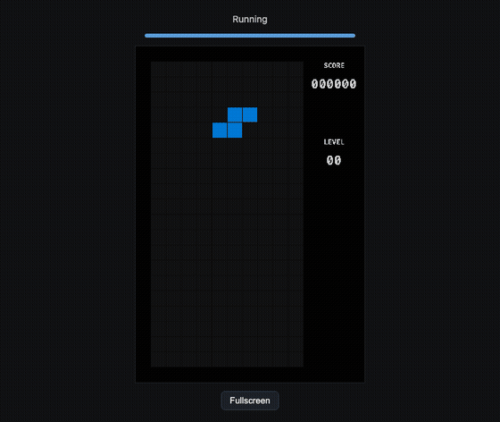
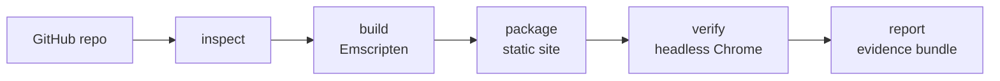

<div align="center">

# browser-port

### Give your agent the power to port any open-source desktop app or game to the browser, so it runs from a link anyone can open.

[](https://github.com/Abelo9996/browser-port/actions/workflows/ci.yml)
[](LICENSE)
[](package.json)
[](#use-it-with-your-agent)



<sub>A C + SDL2 Tetris clone, built to WebAssembly by browser-port and played in headless Chrome during <code>verify</code>.</sub>

[Try it](#try-it) · [Use it with your agent](#use-it-with-your-agent) · [Real ports](#real-ports) · [How it works](#how-it-works) · [Limits](#what-it-cant-do)

</div>

---

Found a great open-source game or tool that only runs on someone's desktop? Ask your agent to port it.
browser-port gives it the operations to do that properly: check whether the code can run in a browser,
compile it to WebAssembly with Emscripten, package a static site, then open it in a real browser and
prove it works. You get a folder you can put on any static host, and a report of everything that was
done and checked.

## Try it

> Not on npm yet. Until the first release, install from GitHub:

```bash
git clone https://github.com/Abelo9996/browser-port && cd browser-port
npm install && npm run build && npm link       # puts `browser-port` on your PATH
brew install emscripten                         # or have Docker running for the emscripten/emsdk image
npx playwright install chromium                 # the browser `verify` uses
```

Then port the Tetris clone from the GIF above:

```bash
browser-port inspect https://github.com/olzhasar/sdl-tetris --dest /tmp/tetris-src --save /tmp/tetris
browser-port build /tmp/tetris --source /tmp/tetris-src \
  --sources src/game.c src/graphics.c src/input.c src/main.c \
  --app-kind sdl2 --libs SDL2 SDL2_ttf --preload-map "src/assets/font.ttf@font.ttf"
browser-port package /tmp/tetris --title "SDL Tetris" --mode canvas --license /tmp/tetris-src/LICENSE
browser-port verify /tmp/tetris --mode canvas --seconds 3
browser-port serve /tmp/tetris/site                # open the printed URL and play
```

What `verify` printed on a fresh run (Apple M4, Emscripten 6.0.12):

```
Verify pass (canvas)
Frames: 166, fps: 55.2, non-blank: true
  note: Canvas content changed across the observation window.
```

## Use it with your agent

```bash
browser-port setup          # shows what it would change
browser-port setup --yes    # registers the MCP server with Claude Code, Codex and Cursor
```

Then just ask:

> "Port github.com/olzhasar/sdl-tetris to the browser and prove it works."

The agent follows [`skills/browser-port/SKILL.md`](skills/browser-port/SKILL.md): inspect first, fix
only what blocks the port, record every source change as a patch, verify in a real browser, and say
plainly when something isn't supported.

> `setup` registers `npx -y browser-port mcp`, which works once the package is on npm. Until then,
> point your agent at the local build instead: `claude mcp add browser-port -- browser-port mcp`.

## Real ports

Every row was produced end to end on a Mac with browser-port. Each folder in [examples/](examples) has
the evidence bundle, screenshots, and the runnable site with the upstream license.

| Program | What it is | Result |
| --- | --- | --- |
| [sdl-tetris](examples/sdl-tetris) | C game, SDL2 + SDL2_ttf | Plays in the browser, about 55 to 57 fps, no console errors |
| [brainheck](examples/brainheck) | C terminal program (stdin/stdout) | Browser output matched the native build for the same inputs |
| [hexyl](examples/not-supported/hexyl) | Rust hex viewer | "Not supported yet", with the reason |

One honest note: sdl-tetris already guarded its main loop for Emscripten, so it needed no source
edits. The tool handles programs that don't (it switches a blocking loop to
`emscripten_set_main_loop` or ASYNCIFY and records the patch), but the examples here don't show that yet.

## How it works



| Step | What it does | Tools it drives |
| --- | --- | --- |
| `inspect` | Language, build system, libraries, assets, entry point, and a verdict: likely, needs changes (each blocker with its usual fix), or not supported | git |
| `toolchain` | Finds a local `emcc`, else the `emscripten/emsdk` Docker image, else tells you how to install it | Emscripten, Docker |
| `build` | Compiles with the right flags (`-sUSE_SDL=2`, asset preloading, memory growth, ASYNCIFY when needed) and records every command | emcc |
| `package` | A self-contained site: canvas or terminal page, loading progress, fullscreen, keyboard focus, an error panel | |
| `serve` | Local preview with the correct wasm MIME type (`--coi` adds the headers threads need) | |
| `verify` | Console errors, non-blank frames, fps, scripted key presses, screenshots; for terminal programs, browser output vs a native build | Playwright, Chromium |
| `report` | Markdown and JSON: repo and commit, toolchain versions, commands, source patch, results, limits | |

Every step is a CLI subcommand (add `--json`) and an MCP tool.

## What it can't do

- Only C and C++ programs that use SDL2, raylib, or plain stdin/stdout for now. Other languages and
  toolkits (GTK, Qt, native OpenGL windowing) get an honest "not supported yet" with the reason.
- No raw TCP or UDP sockets in a browser. Networked programs have to move to WebSockets.
- Threads need cross-origin isolation headers, which many static hosts don't set by default.
- A program that reads all of stdin as its input can't also take interactive input in the terminal page.

## Privacy and safety

Everything runs on your machine. The only network traffic is cloning the repo you ask for and, on the
Docker path, pulling the `emscripten/emsdk` image. It never calls an LLM and sends no telemetry.
`setup` only touches the three agent config files above, backs them up first, and is a dry run unless
you pass `--yes`.

## License

MIT, Copyright (c) 2026 Abel Yagubyan. Ported programs keep their own licenses; `package --license`
copies the upstream license into the site.
