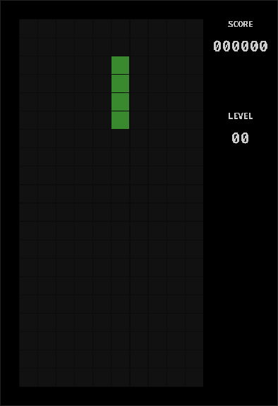

# browser-port

Give your agent the power to port any open-source desktop app or game to the browser, so it runs from
a link anyone can open.

`browser-port` drives Emscripten, a headless browser, and a static site builder. Your agent decides
what to do; the tool does the reliable steps and records evidence at every one. The tool never calls a
model.

## Quickstart

```
npx browser-port setup                 # register the MCP server with your agent (dry run; add --yes to apply)
npx browser-port inspect <github-url>   # is it portable, and what needs changing
npx browser-port build / package / verify / report
```

## Example

Porting [olzhasar/sdl-tetris](https://github.com/olzhasar/sdl-tetris) (C, SDL2, SDL2_ttf) end to end:

```
$ browser-port verify ./tetris --mode canvas --seconds 3 --json
{
  "ok": true,
  "mode": "canvas",
  "consoleErrors": [],
  "canvasNonBlank": true,
  "fps": 57.3,
  "frames": 172,
  "durationMs": 3003
}
```

The game running in headless Chrome, captured by `verify`:



Full write-ups, evidence bundles, and runnable sites for three real ports are in [examples/](examples).

## How it works

Seven operations, available both as CLI subcommands (with `--json`) and as MCP tools:

1. `inspect` clones the repo shallow and reports the language, build system, libraries (SDL2 and its
   image/mixer/ttf add-ons, OpenGL, raylib, pthreads, sockets, filesystem writes), assets, entry
   point, and a portability verdict with each blocker and its usual fix.
2. `toolchain` finds a local `emcc`, or the `emscripten/emsdk` Docker image if the daemon is running,
   or tells you how to install it.
3. `build` compiles to WebAssembly with the right flags: `-sUSE_SDL=2` and friends, asset preloading,
   memory growth, and ASYNCIFY when a blocking main loop is present. Every command is recorded.
4. `package` assembles a self-contained static site: an `index.html` with a canvas (or a terminal for
   stdio programs), loading progress, fullscreen, keyboard focus, and an error panel, plus the
   `.js`/`.wasm`/`.data` files.
5. `serve` previews the site locally with the correct wasm MIME type.
6. `verify` opens the site in headless Chrome and records evidence: console errors, whether the canvas
   draws non-blank frames, frames per second, responses to scripted key presses, and screenshots. For
   stdio programs it compares the browser output against a native build for the same inputs.
7. `report` writes a Markdown and JSON evidence bundle: repo and commit, toolchain versions, every
   command, what was changed in the source and why (as a patch), verification results, and limits.

## Use it with your agent

Run `browser-port setup`. It registers the MCP server with Claude Code, Codex, and Cursor. It is a dry
run by default; pass `--yes` to apply. It backs up existing config files and is idempotent.

- Claude Code: `claude mcp add browser-port -- npx -y browser-port mcp`
- Codex: a `[mcp_servers.browser-port]` entry in `~/.codex/config.toml`
- Cursor: an `mcpServers` entry in `~/.cursor/mcp.json`

Agent instructions live in [`skills/browser-port/SKILL.md`](skills/browser-port/SKILL.md).

## What it can't do

- Only C and C++ programs that use SDL2, raylib, or plain stdin/stdout. Other languages and other
  toolkits (GTK, Qt, native OpenGL windowing frameworks) get an honest "not supported yet" with the
  reason.
- No raw TCP or UDP sockets in the browser. Programs that need networking must switch to WebSocket.
- Threads need COOP and COEP headers and SharedArrayBuffer; `serve --coi` sets the headers for local
  testing.
- A Brainfuck-style program that consumes all of stdin as its source cannot also read runtime input in
  the stdio shell. This and other per-port limits are stated in each report.

## Privacy and safety

Everything runs on your machine. The only things that leave it are the repository you ask it to clone
and, if you use the Docker path, the `emscripten/emsdk` image pull. The tool never calls an LLM and
sends no telemetry. `setup` only writes to the three config files above, backs them up first, and
shows a dry run unless you pass `--yes`.

## License

MIT, Copyright (c) 2026 Abel Yagubyan. See [LICENSE](LICENSE).
