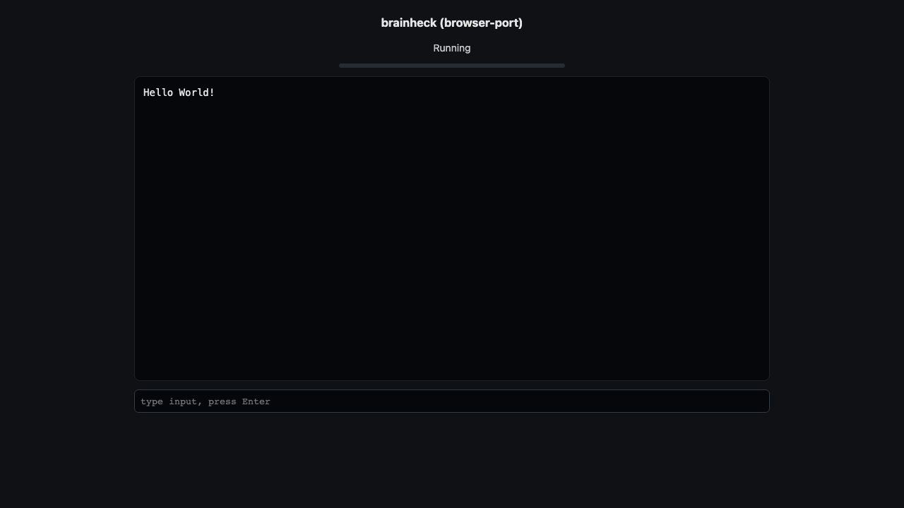

# brainheck ported to the browser

A small Brainfuck interpreter in C that reads a program and runs it, using stdin and stdout.

- Upstream: https://github.com/daniilsjb/brainheck
- Commit: `28032a20d512ffcfcfd5ca6f885cbf03a67f0796`
- License: MIT (kept in `site/LICENSE`)

## Result

`verify` ran the packaged site in headless Chrome and compared its output against the native build for
the same input. The input was the classic "Hello World!" Brainfuck program. Native output and browser
output both were `Hello World!` and matched. See `report.md`, `report.json`, and `screenshots/`.



## Source change

The upstream program reads the Brainfuck source from a file path argument. The port changes `main` to
read the program from stdin when no file argument is given, so it works as a stdin to stdout filter in
the browser. The full diff is in `changes.patch`.

Limit: a Brainfuck program that uses the `,` input command cannot also receive runtime input through
stdin in this build, because stdin is consumed as the program source. The included `mandelbrot.bf`
needs no input and works, but is compute heavy (about 26 seconds).

## Reproduce

```
browser-port inspect https://github.com/daniilsjb/brainheck --dest /tmp/bh-src --save /tmp/bh
# apply the stdin change in /tmp/bh-src/brainheck.c, then:
cc -O2 -std=c99 -o /tmp/bh-src/brainheck_native /tmp/bh-src/brainheck.c
browser-port build /tmp/bh --source /tmp/bh-src --sources brainheck.c --app-kind stdio
browser-port package /tmp/bh --title "brainheck" --mode stdio --license /tmp/bh-src/LICENSE
browser-port verify /tmp/bh --mode stdio --native /tmp/bh-src/brainheck_native \
  --input '++++++++[>++++[>++>+++>+++>+<<<<-]>+>+>->>+[<]<-]>>.>---.+++++++..+++.>>.<-.<.+++.------.--------.>>+.>++.'
browser-port report /tmp/bh --title "brainheck ported to the browser" --patch /tmp/bh/changes.patch
```

## Run it

```
browser-port serve examples/brainheck/site
```

The page reads scripted input from a `?input=<base64>` query parameter, or you can type a Brainfuck
program into the input box and press Enter.
