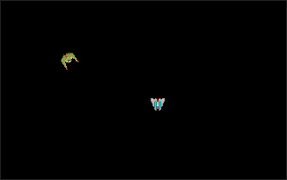

# Space shooter ported to the browser

A small C++ shoot-em-up built on SDL2 and SDL2_image, from chapter 7 of the book
*Hands-On Game Development with WebAssembly*. One `main.cpp` plus the ship, enemy, projectile, and
collider classes.

- Upstream: https://github.com/PacktPublishing/Hands-On-Game-Development-with-WebAssembly (the `Chapter07` directory)
- Commit: `10132e5d6668868588f20667b88a1929b33e2fca`
- License: MIT (kept in `site/LICENSE`)

## Result

Produced in one command with no manual flags. `port` derived the app kind (SDL2), the libraries
(SDL2 + SDL2_image from the includes), and the `sprites/` preload directory. The first build compiled
only `main.cpp` and failed to link; `port` read the undefined symbols and recompiled all seven sources,
which linked. `verify` then opened the site in headless Chrome and recorded no fatal errors and 265
frames over about 4.4 s (60 fps). See `report.md`, `report.json`, and `screenshots/`.



## Reproduce

```
git clone https://github.com/PacktPublishing/Hands-On-Game-Development-with-WebAssembly /tmp/packt
browser-port port /tmp/packt/Chapter07 --out /tmp/packt-shmup
```

## Run it

```
browser-port serve examples/packt-shmup/site
```
